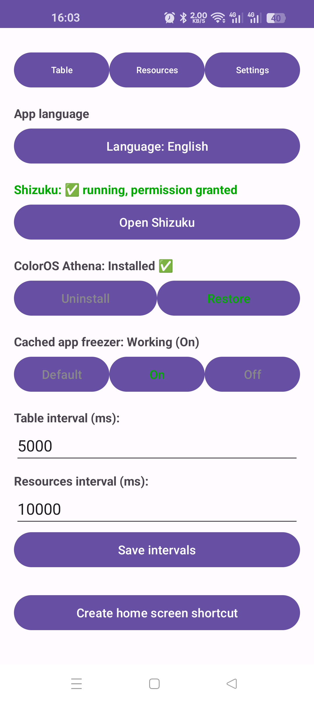
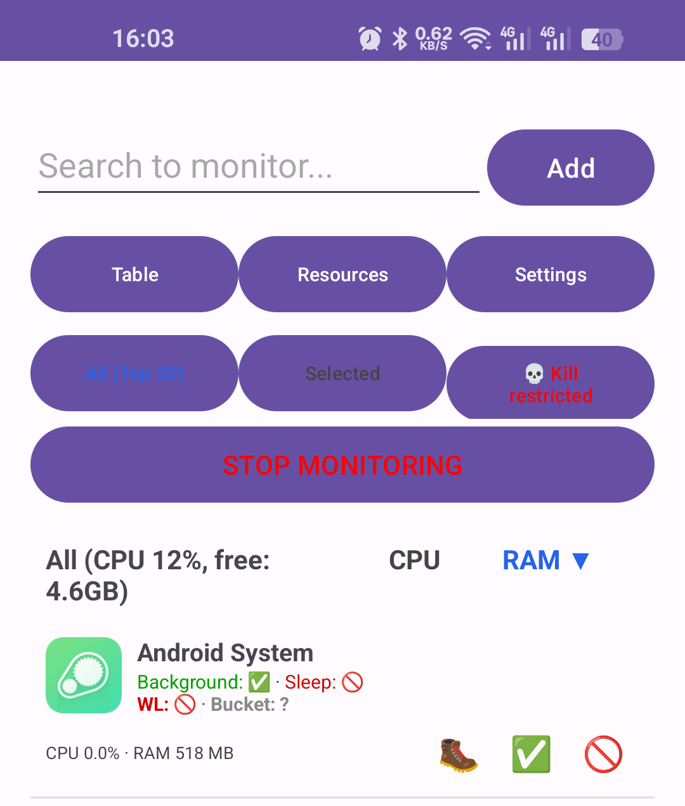

# Monik

**Background app control for Android — built for aggressive Chinese-market ROMs.**

Monik helps you see and control what an app is allowed to do in the background. It is especially
useful on **ColorOS, HyperOS/MIUI, OriginOS, EMUI and similar ROMs**, where battery managers
aggressively freeze apps: notifications stop arriving, messengers go silent, and important
banking, 2FA, wearable or automation apps get killed.

Monik uses [Shizuku](https://shizuku.rikka.app/) (**no root**) to read and change the real
Android state:

- AppOps `RUN_ANY_IN_BACKGROUND` / `RUN_IN_BACKGROUND`
- Doze / battery-optimization whitelist (`deviceidle whitelist`)
- App Standby bucket (`5 = EXEMPTED`, `10 = ACTIVE`, `20 = WORKING_SET`, `40 = RARE`, `45 = RESTRICTED`)
- `force-stop` / `unstop`

## Why Monik

On many Chinese-market phones the battery manager hides *why* an app is protected or killed.
An app can show “background allowed” in the UI while the system still keeps it in the
`EXEMPTED` bucket and ignores the restriction. Monik exposes all four levers in one place:

- **Background** — AppOps `RUN_ANY_IN_BACKGROUND` + `RUN_IN_BACKGROUND`
- **Sleep** — `AUTO_REVOKE_PERMISSIONS_IF_UNUSED` (pause app activity if unused)
- **WL** — user/system Doze whitelist
- **Bucket** — effective App Standby bucket

This makes it possible to:

- keep **important apps alive** so notifications and pushes arrive;
- **restrict unwanted apps** so they do not run or restart in the background;
- diagnose why a “restricted” app still runs, or why an “allowed” app is still killed.

## Screenshots

| Settings | Resources |
|---|---|
|  |  |

## Features

- Per-app indicators for Background, Sleep, WL and Bucket, with green/red status.
- One-tap **Restrict** — the full procedure: remove from the Doze whitelist, set AppOps to
  `ignore`, set the bucket to `restricted`, and force-stop the app.
- One-tap **Allow** — AppOps `allow`, bucket `active`, add to the Doze whitelist, clear the
  stopped state.
- Persistent **Selected** list — apps remain visible even when their process is dead.
- Effective-value read-back: if the ROM overrides `restricted` (for example ColorOS sets
  `10` or `20`), Monik shows the real bucket instead of pretending the change worked.
- CPU/RAM monitor, Usage Stats table, launch-all and force-stop tools.
- ColorOS-specific Athena / cached-app-freezer controls.
- Shizuku status in Settings.
- Ukrainian and English UI, switchable in Settings.
- No `INTERNET` permission. Nothing leaves the phone.

## Requirements

- Android 7.0+ (API 24). Tested on Android 16 / ColorOS.
- [Shizuku](https://shizuku.rikka.app/) running (wireless debugging, ADB or root).
- No root required for the app itself.
- Usage Stats permission is needed only for the **Table** tab. **Resources** works through
  Shizuku without it.

## Download

A **release-signed APK (v1.3)** is attached to
[Releases](https://github.com/vovaxa55/Monik/releases/tag/v1.3).
Older builds are kept in previous releases.

## Changelog

### 1.3

- Fixed the launcher entry on ColorOS: the app is now started through a
  dedicated `activity-alias` (`.Launcher`) instead of the activity that the
  package installer could leave unresolvable after a sideload.
- The **Create home-screen shortcut** action now points to the alias, so a new
  shortcut opens correctly. The button was moved to the top of Settings.
- `versionCode 4`, `versionName 1.3`.

### 1.1

- Release signing with a dedicated key.
- Ukrainian and English UI.
- ColorOS bucket-override warning and release documentation.

## Build

```bash
git clone https://github.com/vovaxa55/Monik.git
cd Monik
echo "sdk.dir=/path/to/Android/Sdk" > local.properties
./gradlew assembleRelease
```

The signed APK is written to:

```text
app/build/outputs/apk/release/app-release.apk
```

Requirements: JDK 17, Android SDK 34, Gradle wrapper included.

## Release signing

Release signing is configured in `app/build.gradle.kts` and reads an optional,
**git-ignored** `keystore.properties` file:

```properties
storeFile=keystore/monik-release.jks
storePassword=CHANGE_ME
keyAlias=monik
keyPassword=CHANGE_ME
```

See `keystore.properties.example`. Generate a key once:

```bash
mkdir -p keystore
keytool -genkeypair -v \
  -keystore keystore/monik-release.jks -storetype PKCS12 \
  -alias monik -keyalg RSA -keysize 4096 -validity 10000
```

If `keystore.properties` is absent, `assembleRelease` produces an unsigned APK.
Never commit `keystore.properties` or the keystore itself.

## Install

```bash
adb install -r app/build/outputs/apk/release/app-release.apk
```

If a debug build is already installed, uninstall it first — debug and release
are signed with different keys and cannot replace each other:

```bash
adb uninstall com.example.monik
adb install -r app/build/outputs/apk/release/app-release.apk
```

Uninstalling clears the app's data (monitored list, language and intervals).

Start Shizuku, grant Monik the Shizuku permission, then open the app.

If the home-screen icon does not open on ColorOS, use **Settings → Create
home-screen shortcut**. Version 1.3 creates the shortcut with the `.Launcher`
alias, which is the component ColorOS can resolve reliably.

If the home-screen icon does not open on ColorOS, use **Settings → Create
home-screen shortcut**. Version 1.3 creates the shortcut with the `.Launcher`
alias, which is the component ColorOS can resolve reliably.

## Usage

1. Start Shizuku and make sure Settings shows `Shizuku: ✅ running, permission granted`.
2. **Table** → search for an app → **Add**.
3. **Resources** → **Selected**.
4. Read the indicators:

   | Indicator | Green | Red |
   |---|---|---|
   | Background | background allowed | background blocked |
   | Sleep | app is not paused | app may be paused/hibernated |
   | WL | whitelisted (exempt) | not whitelisted |
   | Bucket | 5/10 — high priority | 40/45 — restricted |

5. Use **🚫 Restrict**, **✅ Allow** or **🥾 force-stop**.
6. **Settings → App language** to switch between **Українська** and **English**.

## What Restrict / Allow do

**Restrict:**

```text
dumpsys deviceidle whitelist -<pkg>
cmd appops set <pkg> RUN_ANY_IN_BACKGROUND ignore
cmd appops set <pkg> RUN_IN_BACKGROUND ignore
cmd appops set <pkg> AUTO_REVOKE_PERMISSIONS_IF_UNUSED default
am set-standby-bucket <pkg> restricted
am force-stop <pkg>
```

**Allow:**

```text
cmd appops set <pkg> RUN_ANY_IN_BACKGROUND allow
cmd appops set <pkg> RUN_IN_BACKGROUND allow
cmd appops set <pkg> AUTO_REVOKE_PERMISSIONS_IF_UNUSED ignore
am set-standby-bucket <pkg> active
dumpsys deviceidle whitelist +<pkg>
cmd package unstop --user 0 <pkg>
```

Some ROMs silently override these values. Monik reads the effective state back and warns when
the result differs from the request.

## Notes and limitations

- Shizuku must be running. Without it, Monik cannot read or change system state.
- Restricting an app will usually stop its notifications and pushes — that is the point.
- A system whitelist entry (`sys`) cannot be removed without root. Monik shows it separately.
- ColorOS may re-add an app to the whitelist after a reboot or an app update; re-check it.
- Restricting or force-stopping the wrong app can break its functionality. Use the confirmation
  dialogs and keep backups.
- This is a debug build. Use it at your own risk.
- Not affiliated with Google, OPPO, OnePlus, Xiaomi, Tencent or Shizuku.

More technical details and the ColorOS investigation are in
[BACKGROUND_RESTRICTIONS.md](BACKGROUND_RESTRICTIONS.md).

## Українською

Monik — це застосунок для керування фоновою роботою програм на Android через **Shizuku**
(без root). Він показує реальні чотири важелі: AppOps-фон, «Сон», whitelist оптимізації
батареї та standby bucket. Це корисно для китайських прошивок (ColorOS, HyperOS/MIUI,
OriginOS, EMUI), які агресивно «вбивають» фонові програми: важливі месенджери, банкінг,
2FA та носимі пристрої перестають надсилати сповіщення.

Можна дозволити фон для важливих програм (щоб сповіщення приходили) і обмежити зайві
(щоб не працювали у фоні). У «Ресурсах» видно `Фон`, `Сон`, `WL` і `Bucket`; кнопки
🚫/✅ роблять повну процедуру, а 🥾 — force-stop. Мова інтерфейсу перемикається в
«Налаштуваннях»: українська або англійська.
